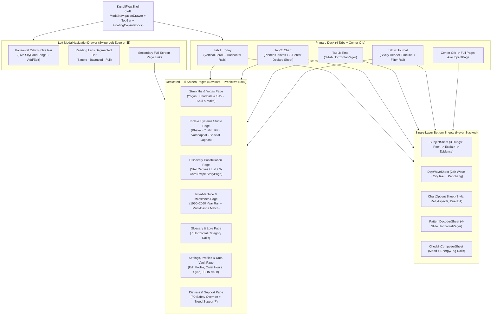

# KundliFlow Android — UX Review & Multi-Surface Wireframes (v4)

> **v4 Focus:** Complete UX review using **scroll-first 2-axis choreography** (horizontal + vertical scrolls & `HorizontalPager`) while keeping **compact Material 3 dropdowns only where genuinely useful** (rare settings or 15+ item pickers), paired with a native Android hierarchy of **Full-Screen Pages, a Left Navigation Drawer, a 3-Detent Docked Sheet, and Single-Purpose Modal Sheets** with full [`apps/web`](file:///Users/krish/Developer/MyAstro/apps/web/src) data parity.

---

## 1. UX Audit: What Needed Fixing & How v4 Solves It

| # | Previous UX Friction | v4 Android Material 3 Solution |
| :--- | :--- | :--- |
| **1** | **Overuse of dropdowns for frequent actions:** `[Priya ▾]`, `[Focus: All ▾]`, and `[City ▾]` hid everyday actions behind popup taps. | **Scroll-first + pragmatic dropdowns:** Frequent switches use the **Left Navigation Drawer**, **horizontal `LazyRow` rails**, and **`HorizontalPager`**. Keep compact Material 3 dropdowns (`DropdownMenu` / `ExposedDropdownMenuBox`) **only where high-cardinality or infrequent**: `[More Vargas ▾]` (after top 5 chips `D1/D9/D10/D2/D4`), `Ayanamsa ▾` under Advanced settings, `[Year ▾]` jump on 1950–2060 timelines, and `⋮` overflow menus. |
| **2** | **"Sheet-ception" (sheets opening sheets):** `MeSheet` opened `EditProfileSheet`, `GlossarySheet`, `ShareBlueprintSheet`, and `DiscoveryMapSheet`; `Chart` stacked 6 modals. | **4-Tier Container Hierarchy:** Promote deep workflows (`Ask AI`, `Strengths & Yogas`, `Tools Studio`, `Discovery Map`, `Time-Machine`, `Glossary`, `Settings & Vault`) to **Full-Screen `NavHost` Pages** with Top Bar `←` & Predictive Back. Keep sheets strictly single-layer. |
| **3** | **Vertical card overload on `Time` & `Chart`:** `Time` stacked 5 heavy cards vertically; `Chart` scrolled the Kundli canvas off-screen when reading houses. | **`Time` uses a 3-tab `HorizontalPager`** (`Chapters` ↔ `Almanac Calendar` ↔ `Transits`). **`Chart` pins the 1:1 canvas** above a **3-Detent Docked Sheet** (`Peek` → `Half` 55% → `Full`). |
| **4** | **Web UI's `StrengthsTab` was fragmented:** Web's rich `Yogas`, `Shadbala`, `Bhava Bala`, `337-pt BAV/SAV`, `Chara Karakas`, and `5-Fold Maitri` were squeezed into small sub-modals. | Added a dedicated **`Strengths & Yogas` Full-Screen Page** (3 swipeable horizontal pages + 2D scrollable matrices), matching [`StrengthsTab.tsx`](file:///Users/krish/Developer/MyAstro/apps/web/src/tabs/StrengthsTab.tsx) 1:1. |
| **5** | **Button-heavy steppers in multi-card stories:** `DiscoveryStory` and `PatternDecoder` required tapping `Next`/`Back` buttons inside a modal. | Converted both into **horizontal swipeable `HorizontalPager` card carousels** with page indicator dots + optional tap zones. |

---

## 2. Container & Navigation Architecture (Pages · Drawer · Docked Sheet · Modal Sheets)



---

## 3. Scroll-First vs. Pragmatic Dropdown Matrix

| Selection Need | Pattern (v4) | Why |
| :--- | :--- | :--- |
| **Switch / Add Profile** | **Left Drawer** + **Horizontal Orbit Avatar Rail** | Everyday 1-swipe access with live `SkyBand` rings |
| **Divisional Charts (`D1–D60`)** | **Horizontal Top-5 Rail** (`[D1] [D9] [D10] [D2] [D4]`) + **`[More ▾]` Dropdown** | Instant 1-tap for the 5 daily charts; compact dropdown for the other 11 (`D3..D60`) without scrolling 16 chips |
| **Life Focus Highlight** | **Horizontal Topic Chip Rail** (`[All] [Career] [Love] [Money] [Home]`) | High-frequency, 5–6 items fit cleanly in one thumb swipe |
| **Hourly Today Forecast** | **Horizontal 24-Hora Pill Strip** (auto-centered on `NOW`) + `DayWaveSheet` | Glanceable time ribbon with direct scrubbable detail |
| **Dasha System & Time Sub-Views** | **Swipeable `HorizontalPager`** (`Chapters` ↔ `Calendar` ↔ `Transits`) + horizontal `[Vimshottari] [Yogini] [Chara]` pills | Eliminates vertical card stacking |
| **Time-Machine / Varshaphal Year** | **Horizontal Nearby-Years Rail** (`2022..2028`) + **`[Year ▾]` Dropdown** (`1950–2060`) | Fast local scrub plus instant 1-tap jump across 111 years |
| **Ayanamsa (`Lahiri`, `KP New`, …)** | **Material 3 `ExposedDropdownMenuBox`** under `Advanced` / `Settings` | Rare one-time configuration; dropdown keeps forms clean |
| **Card / Page Secondary Actions** | **Material 3 `⋮` Overflow `DropdownMenu`** (Copy, Export Dossier, Clear) | Keeps primary action rows calm (max 2 visible buttons) |
| **Ashtakvarga BAV & 5-Fold Maitri** | **2D Scrollable Data Grid** (sticky left planet column + horizontal/vertical scroll) | Preserves full Web UI matrix readability on mobile |

---

## 4. Detailed Wireframes: Shell, Drawer & Primary Tabs

### 4.1 Global App Shell + Left `ModalNavigationDrawer`

```text
+-------------------------------------------------------+      +---------------------------------------------+
| [ ☰ ]  Priya            [ <- Today ]*         [ (Q) ] |      |  KUNDLIFLOW                         [Gear]  |
| Showing your sky from 07:10 · Refresh   (if offline)  |      |  +---------------------------------------+  |
+-------------------------------------------------------+      |  | Taurus Rising · Pisces Moon    [Edit] |  |
|                                                       |      |  | Revati · Lahiri                       |  |
|                 Active Tab Viewport                   |      |  +---------------------------------------+  |
|                                                       |      |  YOUR ORBIT (horizontal scroll)             |
|                                                       |      |  (● Priya)  (● Arjun)  (● Mom)  (+ Add)     |
|                                                       |      |                                             |
|                                                       |      |  READING DEPTH                              |
|                                                       |      |  [ Simple ]   [● Balanced ]   [ Full ]      |
|                                                       |      |  -----------------------------------------  |
|                                                       |      |  ✦  Strengths, Yogas & SAV             ->   |
|                                                       |      |  ⌘  Tools & Systems Studio             ->   |
|                                                       |      |  ✧  Discovery Constellation (9/24)     ->   |
|                                                       |      |  ◷  Time-Machine & Milestones          ->   |
|   +-----------------------------------------------+   |      |  📖 Plain English Glossary             ->   |
|   | Today | Chart |  ( * ) Ask  | Time  | Journal |   |      |  📤 Share 9:16 Cosmic Blueprint        ->   |
|   +-----------------------------------------------+   |      |  ⚙  Settings, Sync & Data Vault        ->   |
+-------------------------------------------------------+      |  -----------------------------------------  |
   Phone Shell (620 dp clear viewport above dock)              |  ♡  Need support? (24/7 Helplines)          |
                                                               +---------------------------------------------+
                                                                  Left ModalNavigationDrawer (300 dp width)
```

---

### 4.2 Tab 1: `Today` (Vertical Scroll + 3 Horizontal Scroll Rails)

```text
+-------------------------------------------------------+
| [ ☰ ]  Priya                                  [ (Q) ] |
+-------------------------------------------------------+
|  +-------------------------------------------------+  |  ^
|  | Good morning                  (cosmicHeroRadial)|  |  |
|  |               (   F l o w i n g   )             |  |  |  Vertical
|  | Jupiter hour until 11:18, then Venus            |  |  |  LazyColumn
|  | Highlights your 10th house of work.       more  |  |  |  (Pull-to-Refresh)
|  +-------------------------------------------------+  |  |
|                                                       |  |
|  +-------------------------------------------------+  |  |
|  | How does now feel?         (1) (2) (3) (4) (5)  |  |  |  Persists for current hour:
|  | -> Logged 4/5 · Edit · Undo                     |  |  |  [Work] [Focus] [Calm] [+ Note] (horiz scroll)
|  +-------------------------------------------------+  |  |
|                                                       |  |
|  +-------------------------------------------------+  |  |
|  | IN THE SKY TODAY                       Dismiss  |  |  |  Single P1–P6 Arbiter Slot
|  | Moon in your chart                              |  |  |
|  | Discovered 9 of 24                 Open map ->  |  |  |  Opens Full-Page DiscoveryMapPage
|  +-------------------------------------------------+  |  |
|                                                       |  |
|  HORA RIBBON  (horizontal scroll, auto-centered NOW)  |  |
|  < [09:00 Ma] [● 10:12 Ju · Flowing] [11:18 Ve] ... > |  |  Tap any pill -> DayWaveSheet at that hour
|                                                       |  |
|  EXPLORE YOUR CHART  (horizontal card rail)           |  |
|  < [Career · H10] [Love · H7] [Wealth · H2]           |  v
|    [Yogas (4)] [Strengths] [Year Ahead] >             |     Routes to Chart, StrengthsPage, or Time
+-------------------------------------------------------+
```

---

### 4.3 Tab 2: `Chart` (Pinned Canvas + Dual Horizontal Rails + 3-Detent Docked Sheet)

- **Zero vertical page scroll trap:** The Kundli canvas never scrolls off screen. Instead, the **Docked Inspector Sheet** slides between `Peek (88 dp)`, `Half (canvas scales smoothly to 55%)`, and `Full (92%)`.
- **Balanced rails + dropdown:** Two compact `34 dp` horizontal scroll rails sit directly under the canvas — Rail 1 for **Top Vargas (`D1`, `D9`, `D10`, `D2`, `D4`) + `[More ▾]` dropdown** (`D3–D60`), Rail 2 for **Perspective & Focus** (`[Lagna] [Moon] | [All] [Career] [Love] [Money] [Home]`). `[⚙]` opens `ChartOptionsSheet`.

```text
+-------------------------------------------------------+
| Taurus rising · Moon in Pisces                  [ ⚙ ] |  <- 1-line header + ChartOptionsSheet trigger
+-------------------------------------------------------+
|                                                       |
|        [ Kundli Chart Canvas — 1:1, Pinned ]          |  <- North Diamond or South 4x4
|     Selected house Gold · Dashed Gold Lord arc        |     (Scales to 55% when Inspector = Half;
|     Teal Moon pulse · Long-press / Switch Drishti     |      Dual side-by-side when Compare D1 is ON)
|                                                       |
+-------------------------------------------------------+
| < [● D1] [D9] [D10] [D2] [D4] [More ▾] >              |  <- Top-5 Horizontal Rail + D3..D60 Dropdown
| < [● Lagna] [Moon] | [All] [Career] [Love] [Money] >  |  <- Horizontal Perspective + Focus Rail
+-------------------------------------------------------+
| ======  (Drag Handle — Peek / Half / Full Detents)    |
| House 10 · Aquarius · Lord Saturn in H12    [<] [>]   |  <- PEEK DETENT (88 dp — always visible)
+-------------------------------------------------------+
| [● Houses (12)] [Planets (9)] [Aspects] [Karakas]     |  <- HALF DETENT: Horizontal Inspector Mode Rail
| +---------------+ +---------------+ +---------------+ |
| | Sign: Aquarius| | Lord: Saturn  | | SAV: 33 bindu | |  <- Horizontal Fact Cards Rail
| +---------------+ +---------------+ +---------------+ |
| • Supportive: Saturn in 12th builds quiet mastery...  |  <- Vertical findings list (inline "Why?" expand)
| [ Full Reading ]    [ Decode 4-Step Chain -> ]        |
|                                                       |
| DEEP DIVE PAGES  (horizontal card rail)               |
| < [Strengths & Yogas ->] [Bhava Dossier ->]           |  <- Navigates to Full-Screen Pages
|   [KP & Chalit ->] [Varshaphal ->] >                  |
+-------------------------------------------------------+
```

---

### 4.4 Tab 3: `Time` (`HorizontalPager` Sub-Tabs + Horizontal & Vertical Scrolls)

Instead of stacking 5 tall cards vertically, `Time` uses a **3-Tab Swipeable `HorizontalPager`** at the top (`[ Chapters | Almanac | Transits ]`):

```text
+-------------------------------------------------------+
| [ ☰ ]  Priya                                  [ (Q) ] |
+-------------------------------------------------------+
|  [● Chapters (Dashas) ]  [ Almanac ]  [ Transits ]    |  <- Swipeable HorizontalPager Tabs
+-------------------------------------------------------+

  --- SUB-PAGE A: CHAPTERS (DASHAS) ---
  < [● Vimshottari (120y)] [Yogini (36y)] [Chara] >     |  <- Horizontal System Rail (no dropdown!)
  +---------------------------------------------------+
  | NOW · VENUS -> SATURN              2.1 yrs left   |
  | Maha: Venus  [===========-------]  (2010–2030)    |
  | Antar: Saturn [==============----] (ends 26 Nov)  |
  | Pratyantar: Mercury · Quiet craft & consolidation |
  +---------------------------------------------------+
  | NEXT SHIFT · Thu 26 Nov           [Diff Preview]  |  <- Inline 3-row Diff: Winds down / Wakes up / House
  +---------------------------------------------------+
  | MAHADASHA TIMELINE (horizontal scroll rail)       |
  | < [Ketu] [● Venus 2010–30] [Sun 2030–36] [Moon] > |  <- Tap any chapter -> vertical Antardasha list below!
  +---------------------------------------------------+
  | [ Open Time-Machine & Life Milestones Page -> ]   |

  --- SUB-PAGE B: ALMANAC CALENDAR ---
  | < [Sep] [Oct] [● Nov 2026] [Dec] [Jan] [Feb] >    |  <- Horizontal Month Rail (replaces arrows/dropdowns)
  | < [● All] [Career] [Travel] [Finance] [Rest] >    |  <- Horizontal Purpose Filter Rail
  | 7-Column Month Grid (Teal / Gold / Amber + ★ dots)|
  | Selected Day Card: Panchang + Flowing Windows     |
  |                    + [ + Log Note / Milestone ]   |

  --- SUB-PAGE C: TRANSITS & GOCHAR ---
  | [ Sade Sati Banner — shown when active/starting ] |
  | Horizontal Planet Filter: <[All] [Sa] [Ju] [Ra]>  |
  | Vertical Cards for all 9 Transiting Grahas:       |
  |    Sign · H from Lagna & Moon · Vedha · Kakshya    |
```

---

### 4.5 Tab 4: `Journal` (Collapsible Pattern Card + Sticky Date Headers + Tag Rail)

```text
+-------------------------------------------------------+
| [ ☰ ]  Priya                                  [ (Q) ] |
+-------------------------------------------------------+
|  +-------------------------------------------------+  |
|  | Your sky patterns · 32 entries       Show math  |  |  <- 2 lines collapsed; expands inline
|  | Flowing hours average 4.4/5; Jupiter leads...   |  |     withHora/Moon horizontal comparison bars
|  +-------------------------------------------------+  |
|  +-------------------------------------------------+  |
|  | This week   (M)(T)(W)(T)(F)(S)(S)  Logged 5 · 4 |  |
|  +-------------------------------------------------+  |
|  < [● All] [Entries] [Milestones] | [#work] [#calm] > |  <- Single horizontal type + tag scroll rail
|                                                       |
|  TODAY                                  (sticky hdr)  |  <- Vertical LazyColumn with stickyHeaders
|  +-------------------------------------------------+  |
|  | 19:20               4/5  [ Flowing · Pisces ]   |  |  <- Tap Sky Chip -> SubjectSheet (Rung 2)
|  | Felt grounded during morning Jupiter hour.      |  |
|  +-------------------------------------------------+  |
|  YESTERDAY                              (sticky hdr)  |
|  +-------------------------------------------------+  |
|  | 21:05               2/5  [ Go gently · Aries ]  |  |
|  +-------------------------------------------------+  |
|                                       [ + Check in ]  |  <- Extended FAB (collapses on scroll down)
+-------------------------------------------------------+
```

---

## 5. Dedicated Full-Screen Secondary Pages (`NavHost`)

### 5.1 `AskCopilotPage` (Full-Screen Conversational Page from Central Orb)

```text
+-------------------------------------------------------+
| [ <- ]  (*) Ask · Priya          [ Fast | Deep ] [ ⋮ ]|  <- Full-screen TopAppBar (Menu: Clear, Export .md)
+-------------------------------------------------------+
| < [● Current] [Career · Tue] [2026 Timing · Sun] >    |  <- Horizontal Recent Sessions Rail
+-------------------------------------------------------+
|  Vertical LazyColumn Conversation Stream:             |
|    (Zero state: Horizontal Topic Starter Cards +      |
|     3 curated prompts + inline "Build a question")    |
|                                                       |
|    +-----------------------------------------------+  |
|    | FROM YOUR CHART                               |  |
|    | Concise 2–4 sentence synthesis...             |  |
|    | < [H10 · Aquarius] [Saturn] [Venus–Saturn] >  |  |  <- Horizontal scrollable Evidence Chips -> SubjectSheet
|    | [ View timing ]   [ Reflect ]           [ ⋮ ] |  |  <- 2 primary actions + [⋮] Copy / Export Dossier
|    +-----------------------------------------------+  |
|    (1-line SSE Reasoning Ticker; tap to expand trace) |
+-------------------------------------------------------+
| < [Prompt Builder] [Pin Event Date] [Compare Year] >  |  <- Horizontal Composer Helper Chips
| [ Ask your chart...                             ] (>) |  <- Sticky IME-padded input bar
+-------------------------------------------------------+
```

---

### 5.2 `Strengths & Yogas Page` (New Full-Screen Web-Parity Hub)

Matches [`StrengthsTab.tsx`](file:///Users/krish/Developer/MyAstro/apps/web/src/tabs/StrengthsTab.tsx) using a **3-Page `HorizontalPager`**:

```text
+-------------------------------------------------------+
| [ <- ]  Strengths & Yogas                     [ Ask ] |
+-------------------------------------------------------+
|  [● Yogas & Audits ] [ Planetary Power ] [ Soul ]     |  <- Swipeable HorizontalPager
+-------------------------------------------------------+
  Page 1 — Yogas & Audits:
    • Horizontal Category Rail: <[All] [Raja] [Dhana] [Pancha Mahapurusha] [Dosha Audit]>
    • Vertical Yoga Cards (Strength % bar, participating planets, plain meaning, classical rule)
    • Dosha Bhanga Shield Section (Cancelled / Verified Absent / Active)

  Page 2 — Planetary Power (Shadbala & Ashtakvarga):
    • Horizontal 9-Planet Spotlight Cards (<[Ju 1.34x] [Ve 1.21x] [Sa 1.08x]...>)
    • Vertical 6-Fold Shadbala Breakdown Bars (Sthana, Dig, Kala, Cheshta, Naisargika, Drik)
    • 2D Scrollable Ashtakvarga Matrix (Sticky Planet Column + Horizontal 12-Sign Scroll = 337 SAV)

  Page 3 — Soul Drivers & Harmonics:
    • Jaimini Chara Karakas Vertical List (Atmakaraka -> Darakaraka)
    • Vaisheshikamsa D-Chart Dignity Badges
    • 2D Scrollable 5-Fold Friendship Matrix (Panchadha Maitri: Intimate / Friend / Neutral / Enemy)
```

---

### 5.3 `Tools & Systems Studio Page` (Full-Screen Specialist Workbench)

Promoted from a bottom sheet to a **Full-Screen Page** with a **6-Tab Scrollable `TabRow` + `HorizontalPager`**:

```text
+-------------------------------------------------------+
| [ <- ]  Tools & Systems Studio          [ Dossier ]   |
+-------------------------------------------------------+
| < [● Bhava Dossier] [Chalit] [KP System]              |  <- Scrollable TabRow + HorizontalPager
|   [Varshaphal] [Special Lagnas] [Avakahada] >         |
+-------------------------------------------------------+
  • Bhava Dossier: Horizontal House Pill Rail <[H1]..[H12]> + full lordship, occupants, aspects & rules.
  • Chalit: Sripati Bhava Chalit cusp midpoints/starts + shifted planets highlight cards.
  • KP System: 12 Cusps (Sign / Star-Lord / Sub-Lord) + 4-Tier Planet Significator matrix.
  • Varshaphal: Horizontal Year Rail <[2024] [2025] [● 2026] [2027]> + Muntha + horizontal Saham search/category rail + vertical 36 Sahams list.
  • Special Lagnas: Hora/Ghati/Bhava Lagnas + 12 Arudha Padas (AL, UL, A10) + 7 Upagrahas.
  • Avakahada: Birth Panchang + 6-cell Avakahada Chakra + Julian Day UT & Ayanamsa offset.
```

---

### 5.4 `DiscoveryMapPage`, `TimeMachinePage`, `GlossaryPage`, & `SettingsPage`

| Full-Screen Page | Scroll & Interaction Layout |
| :--- | :--- |
| **`DiscoveryMapPage`** | Top Bar `[<-] Constellation (9/24)` + `[Map \| List]` toggle → Horizontal Ring Rail `<[All] [Core] [Houses] [Timing] [Depth]>` → Interactive 2D pan/zoom star canvas → Tapping a star opens **`DiscoveryStoryPager`** (3 full-bleed horizontal swipe cards: `Hook → Chart Reveal → Try & Reflect`). |
| **`TimeMachinePage`** | Top Bar `[<-] Time-Machine` → **Horizontal Year Scrubber Rail (`1950–2060`)** → Live matched `Vimshottari + Yogini + Chara` active chapters card → Vertical Life Milestones timeline + `[+ Add Milestone]` sheet + `[Ask AI about <Year>]`. |
| **`GlossaryPage`** | Top Bar + sticky Search field → **Horizontal 7-Category Rail** (`Core`, `Houses`, `Daily Rhythm`, `Timing`, `Strengths`, `Yogas`, `Systems`) → Vertical expandable plain-English + classical note cards. |
| **`SettingsAndVaultPage`** | Opened from Drawer `⚙`: Profile Birth Details Editor (native Material 3 Date/Time pickers + `PlacePickerSheet` + horizontal Ayanamsa rail), Horizontal Quiet Hours rail, Calm Morning Summary switch, Cloud Sync Sign-In/Out, JSON Vault Export/Restore, and Vault Reset. |

---

## 6. Focused Single-Layer Bottom Sheets

| Sheet | Type & Detents | Purpose |
| :--- | :--- | :--- |
| **`ChartInspectorSheet`** | **Docked** (`Peek 88dp` · `Half 55%` · `Full 92%`) | Co-exists with pinned `Chart` canvas; holds Houses/Planets horizontal mode rail, facts, findings, and Deep Dive page links. |
| **`SubjectSheet`** | **Modal** (`Peek 40%` · `Explain 70%` · `Evidence 95%`) | Universal 3-rung quick inspection from any chip/planet/house tap across the app; sticky `[Ask]` & `[Reflect]` footer + Predictive Back across rungs. |
| **`PatternDecoderSheet`** | **Modal** (`HorizontalPager`, 4 slides) | Swipeable 4-step visual chain (`1. Sign → 2. Lordship → 3. Occupants & Drishti → 4. SAV & Timing`). |
| **`DayWaveSheet`** | **Modal** (`Half / Full`) | 24h scrubbable wave (with TalkBack hour steppers), horizontal City switcher rail, and Today's Panchang. |
| **`ChartOptionsSheet`** | **Modal** (`Compact`) | `North / South` chips, `Show Drishti aspects` switch (TalkBack parity), and `Compare with D1` dual-chart switch. |
| **`CheckInComposerSheet`** | **Modal** (`Compact`) | Mood `1–5` circles, horizontal Energy & Tag chip rails, optional Note, and pre-storage `SafetyEvaluator` check. |

---

## 7. Adaptive Tablet / Foldable Layout (`WindowSizeClass`)

- **Medium (`600–839 dp`):** Persistent Left `NavigationRail` (with `Ask` orb + Drawer toggle). `Chart` renders Canvas on left (`55%`) and permanent Inspector pane on right (`45%`). `Today`, `Time`, and `Journal` use balanced 2-column master/detail grids.
- **Expanded (`840+ dp`):** Permanent Navigation Drawer or Rail + 2-column content + optional `420 dp` docked `AskCopilot` right-hand companion pane.
