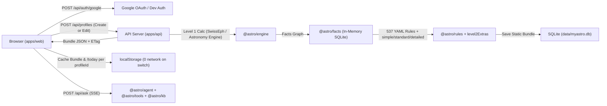

# System Architecture — KundliFlow (MyAstro)

KundliFlow uses a **Server-Compute-Once + Local-First Thin Client** architecture. Heavy astronomical and rule-evaluation workloads run once per birth chart edit on the Node.js API server (`apps/api`) and are persisted in SQLite (`data/myastro.db`) plus cached in `localStorage` on the browser (`apps/web`).

---

## High-Level Data Flow

---

## Three Computation Tiers

1. **Level 1 — Deterministic Engine (`@astro/engine`)**
   - Computes sidereal planetary positions (`Lahiri`, `KP New`, `KP Old`, `Raman`, `Yukteshwar`), divisional charts (`D1`–`D60`), Sripati Bhava Chalit, KP Sub-Lords, Shadbala, Ashtakvarga (Bhinna, Sarva, Prastara, Shodhana), Vimshottari / Yogini / Chara Dashas, Panchang, Avakahada, Ghatak, Arudha Padas, Upagrahas, Varshaphal, Sahams, and classical Yogas/Doshas.
   - Uses Swiss Ephemeris WASM (`swisseph-wasm@2.10.03+moshier`) on the API server (`apps/api/src/server.ts`), with `astronomy-engine` available as an automatic fallback provider.

2. **Level 2 — Structured Interpretations (`@astro/facts`, `@astro/rules`, `level2Extras.ts`)**
   - Evaluates 537 declarative YAML rules (`packages/content/rules/*.yaml`) over an in-memory chart facts graph.
   - Precomputes **three reading depths** once at profile save/update time:
     - `simple` (plain-English guidance)
     - `standard` (house/planet causal breakdowns)
     - `detailed` (rule IDs, strength scores, full extras)

3. **Level 3 — Grounded AI Jyotish Copilot (`@astro/agent`, `@astro/tools`, `@astro/kb`)**
   - Multi-turn agent queries `chart.db` via virtual filesystem paths (`/overview`, `/houses/1..12`, `/planets/<name>`, `/sahams`) and deterministic calculators (`EngineSession`).
   - Output is checked by `verifier.ts` against observed tool evidence IDs (`mode: 'level3_verified'`).
   - If upstream LLM credentials (`ANTHROPIC_*` or `LLM_*`) are missing or unreachable, `/api/ask` degrades cleanly to deterministic output (`mode: 'level2_fallback'`).

---

## Local-First Caching vs. Recalculation

- **Zero-WASM Frontend**: `apps/web/vite.config.ts` aliases `@swisseph/browser` to `src/noop-swisseph.ts`. CI checks `apps/web/dist/assets/*.wasm` to guarantee zero WASM bytes ship to the browser.
- **Profile Switching (`0` Network Calls)**: Once a chart bundle (`astro_server_bundle_v2_<id>`) and daily sky (`astro_server_today_v1_<id>`) are cached locally, switching profiles or reloading reads from `localStorage` without hitting `/bundle`, `/today`, `/auth/me`, `/activate`, or `/sync`.
- **Create or Edit Re-Sync**: Creating a chart (`mode: 'add'`) or editing birth date, time, location, coordinates, timezone, or ayanamsa (`mode: 'edit'`) triggers `forceRecompute = true`, clears stale caches, calls `POST /api/profiles`, increments `bundleVersion` in SQLite, invalidates `daily_sky_cache`, and updates the UI cleanly.
